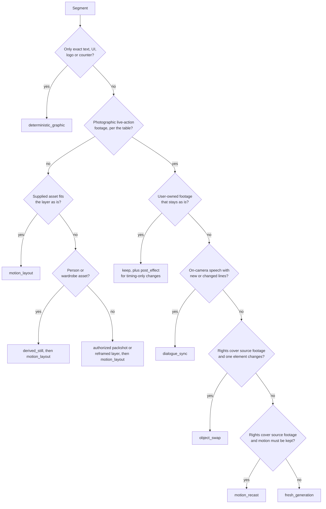

# Segment Routing

Every EDL segment gets exactly one route, chosen from what the measured
reference segment shows, not from the genre of the edit. Mixed edits are
normal: a fashion lookbook can cut sticker cutouts against walking footage, an
aura edit can drop a cutout over a collage between cinematic shots. Type and
effects are always deterministic on top of any route.

## Read the segment first

| The reference segment shows | It needs |
| --- | --- |
| The camera moving through a photographic space, parallax in depth, a subject's body moving (walk, turn, dance), a physical interaction (pour, fold, wear), a speaker on camera | Footage |
| Hard alpha edges or a sticker outline, a flat, paper or collage background, a subject held still while layers move, screenshots, UI, packshots, cards | Layers |
| Only type, logo, counter or UI | A deterministic graphic |

Record the signals that decided it in the segment's route reason. A static
camera does not make a segment layers: a locked-off talking head or a top-down
pour is still live-action footage. When the frames are ambiguous and the
segment carries the hero subject, ask or route it to footage; default to the
cheaper layered route, with the doubt recorded, only for background segments.

## Decision order

**Label check on every footage route.** When a readable product label or
packshot is in frame on `fresh_generation`, `motion_recast`, `object_swap` or
`dialogue_sync`, add the `label_composite` treatment.

## Routes

| Route | Method | Notes |
| --- | --- | --- |
| `motion_layout` | HyperFrames composition: asset layers animated with keyframes, masks, easing, parallax, type and transitions on the EDL timeline | For posed, graphic, cutout, card and packshot segments. Supplied photos are placed as unaltered pixels. No credits |
| `derived_still` | A Seedream edit or try-on still of a person or wardrobe built from the supplied assets (for example `seedream-character-outfit` for a model wearing a flat-lay outfit), then placed as a layer | For person and wardrobe layers the supplied photo cannot fill as it is; never for products, logos or labels, which need an authorized packshot or a reframed layer. A real person's derived still needs consent covering generated edits of their likeness. Generative stills follow the three-sample selection set and their own review |
| `deterministic_graphic` | One HTML entrypoint rendered by `html-graphic-render`, animated in HyperFrames when it moves | Exact copy, fonts, UI, logos, price and CTA cards, counters, lower-thirds, captions |
| `keep` | Place the user's own footage unchanged | Record the source hash |
| `post_effect` | FFmpeg or HyperFrames on kept or generated footage | Speed ramps, flashes, freezes, zooms, transitions |
| `fresh_generation` | Seedream first frame with the locked identity references at the reference aspect ratio, then Seedance 2.5 image-to-video, prompt per `seedance-prompt-25` | For footage segments with no usable source. One take per setup, cut into its appearances |
| `label_composite` | A treatment on any footage route: the label turned away, out of focus or on a plain stand-in of the same shape and colour, plus the real packshot or label as a layer | The readable moment is a layered insert or a held frame with the real label composited in HyperFrames. Tracked label replacement on moving footage is not promised; record it as a risk when the brief needs it |
| `dialogue_sync` | The speaker says approved lines: Seedance 2.5 native dialogue bound to the speaker's identity asset, or `omnihuman-prompt-20` from one approved image plus the approved voice track when a still-led talking head is enough | Voice from the person's own recording or a cloned voice with voice consent. A presenter run longer than the live duration range is windowed at speech boundaries, or routed to OmniHuman. After the final voice exists, the segments are re-timed from its word timings |
| `motion_recast` | `seedance-motion-recast` | Source clip, rights recorded, cast and world rebuilt around the same performance |
| `object_swap` | `seedance-object-swap` | One named element changes, rest preserved; footage owned or permitted |

## Setups

Generated and recast segments are grouped into **setups** before any request
is drafted.

1. Cluster footage segments by subject, location, shot size and angle, and
   action. Reappearances of one shot in a fast edit share a setup.
2. The setup count follows the reference: one for a single long take, a few
   for a three-shot cinematic edit, dozens for a 90 s edit cutting between
   many locations. No fixed count applies.
3. Each setup's take duration is its longest continuous use plus handles,
   never below the live minimum. A use longer than the live maximum is split
   at a hidden boundary (a whip, an occlusion, a cut in the reference) or
   chained.
4. When the setup count times the estimate exceeds the cap, merge the closest
   setups (same subject and light, nearby angles), record the merge and its
   cost saving, and show the user which reference shots now share a take.

## Layer preparation

- Cutouts need clean alpha. Produce them with a masking step (for example a
  `seedream-edit` background removal on the supplied photo) and inspect edges
  at 100 %; reject halos, lost fingers, cropped soles or label damage.
- Product and logo pixels stay as supplied. Never redraw them.
- Keep original and cutout hashes; a cutout is a derived asset with its own
  review.
- Plan safe margins for the reference's aspect ratio and the motion's travel.

## Generation windows

1. Resolve the live duration range, reference limits and supported
   parameters (for example whether `ratio` is accepted with a first frame)
   first; do not carry a parameter rule over from an earlier run unchecked.
2. Group consecutive segments of one setup, or of setups that share subject,
   location and light, into one window when their total fits the range.
   Otherwise generate each setup separately.
3. A window with hard cuts is generated as one clip, then cut at the EDL times
   in the assembly. Expect shifts of roughly 0.5–1.2 s on dense timelines;
   retime by trimming or clone-padding rather than regenerating.
4. A window never crosses a layered or kept segment.
5. Record per window: member segment IDs, setup IDs, requested duration,
   resolution (480p draft first), estimated cost and assigned assets in
   binding order.
6. Each window's prompt is a draft for the caller's `prompt-review`, frozen
   snapshot and registry entry; this skill never submits it.

## Reference footage as input

Binding the reference itself as a video input is allowed only for
`motion_recast` and `object_swap` with recorded rights, a muted source master
and the [video-to-video inputs contract](../../../contracts/video-to-video-inputs.md).
For layered and generated routes, describe the reference's structure and motion
in text and measurements; do not bind its frames.
